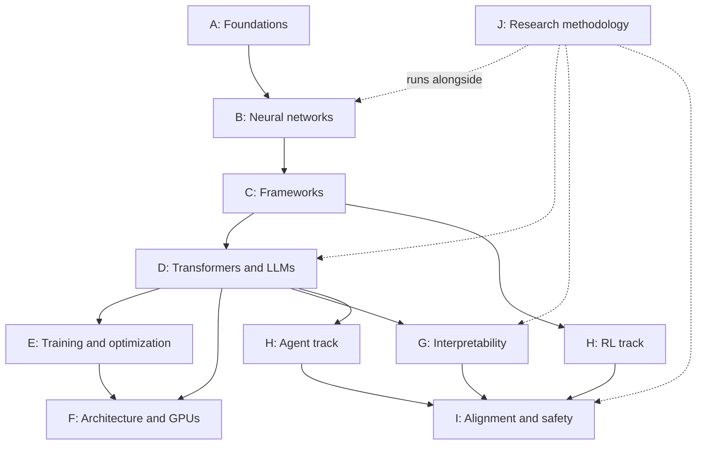

# Roadmap

A first-principles path from mathematical foundations to original AI research. Each phase has its own document with the same ten sections: purpose, prerequisites, learning objectives, theory, implementation, experiments, resources, completion criteria, research directions, and common misconceptions.

## Contents

- [Phases](#phases)
- [Dependencies and parallel tracks](#dependencies-and-parallel-tracks)
- [How to work through a phase](#how-to-work-through-a-phase)
- [Progress tracker](#progress-tracker)
- [Open questions for the learner](#open-questions-for-the-learner)

## Phases

| Phase | Document | Focus | Key milestone |
|---|---|---|---|
| A | [Mathematical foundations](00-foundations.md) | Linear algebra, calculus, probability, information theory, numerics, optimization | A2: numerical gradient checker |
| B | [Neural networks from scratch](01-neural-networks.md) | Regression, MLPs, backpropagation derived by hand, in NumPy | B3: XOR network with manual backpropagation |
| C | [Deep learning frameworks](02-deep-learning-frameworks.md) | NumPy in depth, PyTorch tensors and autograd, training engineering | C2: autograd matches your manual gradients |
| D | [Transformers and LLMs](03-transformers-and-llms.md) | Tokenization, attention, GPT from scratch, inference, post-training | D11: GPT-2 weights running in your own code |
| E | [Training and optimization](04-training-and-optimization.md) | Optimizers, schedules, mixed precision, memory and compute accounting, distribution | E5: memory model that predicts measured usage |
| F | [Computer architecture and GPU computing](05-computer-architecture-and-gpu-computing.md) | Memory hierarchy, GPU execution, roofline, C++ and CUDA kernels | F3: tiled CUDA matmul compared to cuBLAS |
| G | [Model interpretability](06-model-interpretability.md) | Probes, circuits, activation patching, sparse autoencoders | G4: induction heads with causal evidence |
| H | [Agentic AI and reinforcement learning](07-agentic-ai-and-reinforcement-learning.md) | MDPs, policy gradients, agent loops, permissions, prompt injection | H7: permission layer independent of model output |
| I | [AI alignment and safety](08-ai-alignment-and-safety.md) | Specification gaming, robustness, oversight, behavioral evaluation limits | I1: specification gaming demonstrated and fixed |
| J | [Research methodology](09-research-methodology.md) | Hypotheses, experimental design, statistics, replication, writing | J4: a small-scale replication report |

Phase letters are used in text; file numbers keep the documents sorted.

## Dependencies and parallel tracks

In words:

- **A → B → C → D** is the critical path. Do not skip it.
- After D, **E, F, and G can be interleaved** according to interest. F's CPU and C++ portion can begin earlier, but CUDA waits until you understand the operations being accelerated.
- **H** has two tracks: reinforcement learning (after C) and language-model agents (after D).
- **I** draws on D, G, and H.
- **J is continuous**, starting with your first experiment in Phase B. Its stages are described in [Phase J §1](09-research-methodology.md#1-purpose).
- NumPy basics ([Phase C §3.1](02-deep-learning-frameworks.md#31-python-and-numpy-for-scientific-computing-can-start-alongside-phase-a)) can be learned alongside Phase A.

No deadlines are imposed. Depth matters more than pace; a phase is done when its completion criteria have evidence, not when time runs out.

## How to work through a phase

1. **Read the purpose and prerequisites.** Fill gaps with the just-in-time topics listed there.
2. **Study the theory** with the core resources. Re-derive equations on paper.
3. **Log as you go** with the [learning-log template](../learning-log/TEMPLATE.md), especially what remains unclear.
4. **Implement the milestones in order.** Each milestone is checked against something independent: a numerical gradient, a reference implementation, or a known result.
5. **Run the experiments** with the [experiment template](../experiments/TEMPLATE.md). Write the hypothesis before running.
6. **Read papers** with the [paper template](../papers/TEMPLATE.md) as the phase calls for them.
7. **Check the completion criteria.** Tick a box only with a link to evidence.
8. **Record new questions** in the [research backlog](../research-backlog.md).

Within a phase, material is labeled **core**, **optional advanced**, or **research directions**. Core is required for completion; the rest is for depth or later return.

## Progress tracker

This table is the single source of truth for phase status. Status values and evidence rules are defined in [progress conventions](../README.md#progress-conventions). Individual milestones and criteria are tracked as checkboxes inside each phase document.

| Phase | Status | Started | Completed | Evidence |
|---|---|---|---|---|
| A — Foundations | Not started | — | — | — |
| B — Neural networks | Not started | — | — | — |
| C — Frameworks | Not started | — | — | — |
| D — Transformers and LLMs | Not started | — | — | — |
| E — Training and optimization | Not started | — | — | — |
| F — Architecture and GPUs | Not started | — | — | — |
| G — Interpretability | Not started | — | — | — |
| H — Agentic AI and RL | Not started | — | — | — |
| I — Alignment and safety | Not started | — | — | — |
| J — Research methodology | Not started | — | — | — |

**Current phase:** Phase A (not yet started).
**Next milestone:** Phase A self-assessment ([Phase A §2](00-foundations.md#2-prerequisites)), then milestone **A1**.

## Open questions for the learner

These choices affect later phases; they are recorded here until decided.

- **Hardware:** Is an NVIDIA GPU available locally, or will GPU work use a cloud provider? This affects C6, Phase E measurements, and all CUDA work in Phase F.
- **Time budget:** Rough hours per week, used only to choose between optional and core material — not to set deadlines.
- **Model access for the agent track:** a local open-weights model, a hosted API, or both. This affects cost and reproducibility in Phases H and I.
